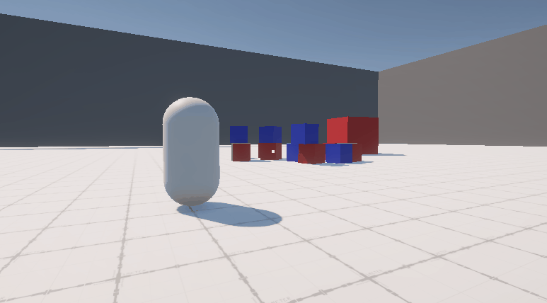
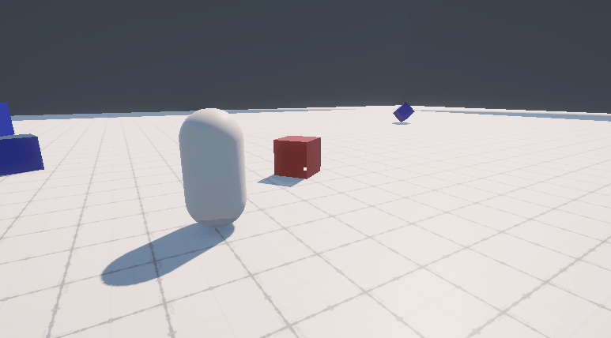
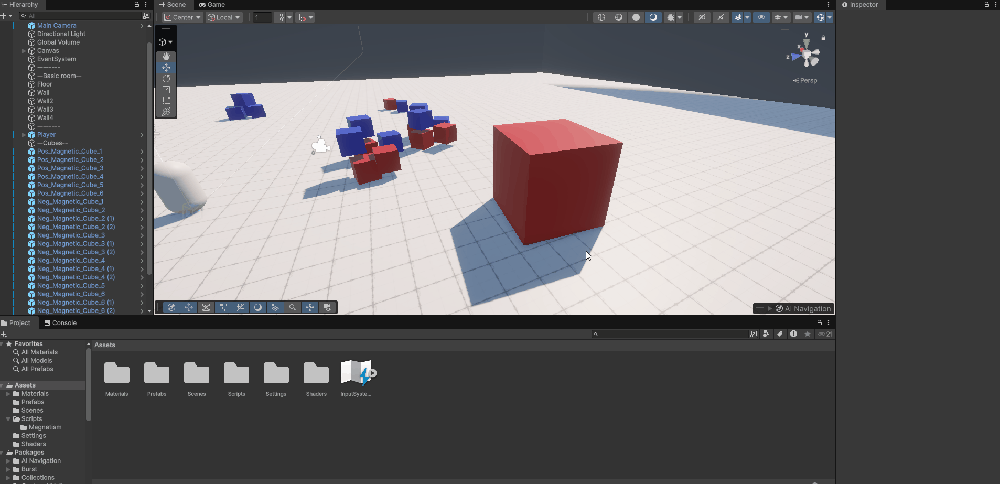

# Unity - Magnetic System

A polarity-based magnetic interaction system developed in Unity using C# and Shader Graph.

The player can switch between positive and negative polarity, attracting and repelling magnetic objects.

## Gameplay Preview

*Attracting and repelling multiple objects.*

*Optionally, a magnetic object can periodically switch between polarities.*

## Features

- **Polarity based interactions:** Attract or repel magnetic objects depending on the player's active polarity.
- **Multiple object detection:** Detect and interact with multiple magnetic objects simultaneously.
- **Distance-based force:** Magnetic force varies with the distance between the player and each target.
- **Automatic polarity switching:** Magnetic objects can automatically switch polarity at configurable intervals.
- **Shader-based visual feedback:** Use color and shader effects to indicate the player's active polarity and highlight affected objects.

## Controls

| Input | Action |
|---|---|
| Left mouse button (hold) | Activate positive polarity |
| Right mouse button (hold) | Activate negative polarity |
| Escape | Unlock cursor |

## Editor Workflow

Magnetic objects can have their polarity configured directly in the Unity inspector. Changing an object's polarity automatically updates its material, making magnetic objects easy to configure and reuse.

*Changing an object's polarity in the inspector automatically updates its appearance*

## How It Works

### Magnetic interactions

The player detects magnetic objects within the aiming area using `Physics.SphereCastAll`. Detected objects are filtered to identify valid magnetic targets.

The force direction depends on the relationship between the player's active polarity and the target object's polarity:

- **Opposite polarities:** Attraction.
- **Same polarities:** Repulsion.

Magnetic force varies with the distance between the player and each target, providing more control over nearby objects.

### Visual feedback

Shader effects communicate magnetic interactions to the player. Affected objects receive a visual highlight, while the player's color indicates the currently active polarity.

### Automatic polarity switching

Magnetic objects can be configured to automatically alternate between positive and negative polarities at configurable time intervals. This introduces an additional gameplay challenge by changing the interaction between the player and the object over time.

## Technical Overview

The system separates input handling, player movement, magnetic interactions, and visual feedback into dedicated components.

| Component | Responsibility |
|---|---|
| `PlayerInputReader` | Reads player input. |
| `PlayerMovement` | Handles player movement. |
| `PlayerMagnet` | Manages magnetic interactions, detects magnetic objects and applies forces. |
| `MagneticObject` | Stores an object's polarity and manages its own visual feedback. |
| `PlayerPolarityVisual` | Updates the player's appearance based on the active polarity. |
| `MagneticPolaritySwitcher` | Periodically switches an object's polarity. |

## Built With

- **Engine:** Unity 6 LTS (6000.3.27f1)
- **Language:** C#
- **Effects:** Shader Graph
